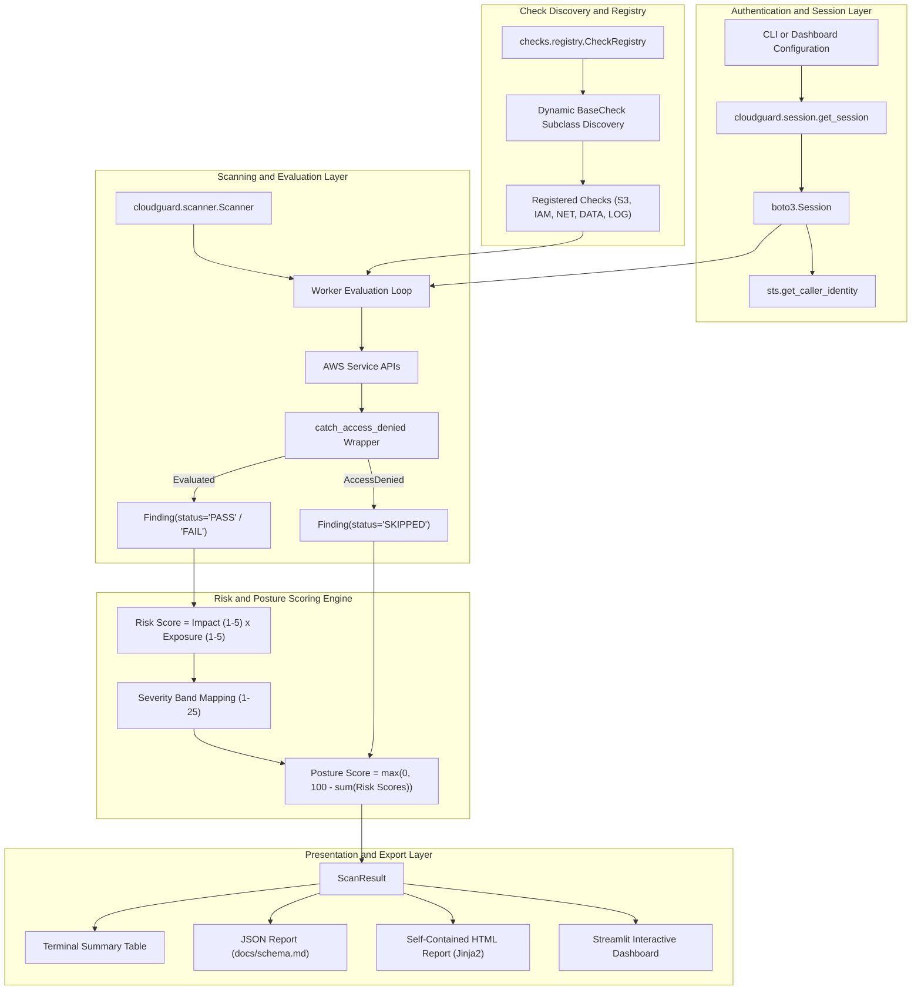

# CloudGuard

CloudGuard is a modular, read-only AWS security assessment scanner written in Python 3.11. Developed as a cloud computing project, it evaluates target AWS accounts against selected Center for Internet Security (CIS) AWS Foundations Benchmark controls, computes transparent two-dimensional risk scores, and exports assessment findings via an interactive Streamlit dashboard, a self-contained HTML report, and a structured JSON schema.

---

## Architecture Overview

CloudGuard decouples credential resolution, check discovery, execution, quantitative risk scoring, and multi-format presentation. The scanner invokes only AWS read-only APIs (`describe_*`, `get_*`, and `list_*`). If an API call fails due to missing IAM permissions (`AccessDenied`), CloudGuard intercepts the exception and produces a structured `SKIPPED` finding rather than interrupting execution.



For detailed component interaction specifications, refer to [docs/architecture.md](docs/architecture.md).

---

## Project Structure

```text
cloudguard/
├── cloudguard/                    # Core scanner package
│   ├── __init__.py
│   ├── checks/                    # Modular CIS security checks
│   │   ├── __init__.py
│   │   ├── base.py                # BaseCheck abstract class and error-wrapping helpers
│   │   ├── registry.py            # Dynamic check auto-discovery registry
│   │   ├── s3.py                  # S3-01, S3-02, S3-03
│   │   ├── iam.py                 # IAM-01, IAM-02, IAM-03, IAM-04
│   │   ├── network.py             # NET-01, NET-02
│   │   ├── data.py                # DATA-01, DATA-02
│   │   └── logging_checks.py      # LOG-01
│   ├── collectors/                # Read-only AWS resource collectors
│   │   └── __init__.py
│   ├── config.py                  # Environment variable and profile configuration
│   ├── session.py                 # boto3 session factory and STS identity verification
│   ├── models.py                  # Finding dataclass, Severity enum, ScanResult
│   ├── scoring.py                 # Two-dimensional risk scoring engine
│   ├── scanner.py                 # Check orchestration and result aggregation
│   ├── report.py                  # HTML and JSON report generation
│   └── cli.py                     # Command-line interface entry point
├── dashboard/
│   └── app.py                     # Streamlit interactive dashboard
├── templates/
│   └── report.html.j2             # Jinja2 self-contained HTML report template
├── tests/                         # Pytest test suite (moto and botocore Stubber)
│   ├── test_checks_base.py
│   ├── test_checks_s3.py
│   ├── test_checks_iam.py
│   ├── test_checks_network.py
│   ├── test_checks_data.py
│   ├── test_checks_logging.py
│   ├── test_cli.py
│   ├── test_dashboard.py
│   ├── test_evaluation.py
│   ├── test_models.py
│   ├── test_registry.py
│   ├── test_report.py
│   ├── test_scanner.py
│   ├── test_scoring.py
│   ├── test_session.py
│   └── test_testbed.py
├── testbed/                       # Controlled vulnerable environment provisioning
│   ├── create_vulnerable.py       # Deploys intentionally misconfigured AWS resources
│   ├── destroy_vulnerable.py      # Idempotent teardown from manifest.json
│   └── README.md
├── evaluation/                    # Detection accuracy measurement
│   ├── evaluate.py                # Planted-issue matching, recall, FP analysis
│   ├── results.md                 # Generated evaluation report (before/after)
│   └── README.md
├── docs/                          # Technical documentation
│   ├── architecture.md            # System architecture and Mermaid diagrams
│   ├── iam-setup.md               # IAM policies, authentication configuration
│   ├── scoring.md                 # Risk scoring model specification
│   ├── schema.md                  # JSON report schema definition
│   └── README.md                  # Documentation index
├── requirements.txt               # Python dependencies
├── .gitignore
└── README.md
```

---

## Prerequisites and IAM Setup

### Prerequisites
- Python 3.11 or Python 3.12 (Python 3.14 compatible)
- AWS CLI configured with active credentials
- Read-only IAM credentials for the target AWS account

### Required IAM Permissions
CloudGuard strictly executes read-only operations. To run scans without permission errors, attach one of the following policies to the scanning IAM identity:

1. **AWS Managed Policy: `SecurityAudit` (Recommended)**
   - Policy ARN: `arn:aws:iam::aws:policy/SecurityAudit`
   - Provides read-only access to inspect security configurations across all supported AWS services.
2. **Alternative Managed Policy: `ViewOnlyAccess`**
   - Policy ARN: `arn:aws:iam::aws:policy/ViewOnlyAccess`
3. **Minimal Custom IAM Policy**
   - If least-privilege scoping is required, deploy the custom read-only policy provided in [docs/iam-setup.md](docs/iam-setup.md).

---

## Installation

### 1. Clone the Repository
```bash
git clone https://github.com/example/cloudguard.git
cd cloudguard
```

### 2. Set Up Virtual Environment
```bash
python3 -m venv .venv
source .venv/bin/activate
pip install -r requirements.txt
```

### 3. Verify Test Suite
Execute the test suite to confirm installation integrity:
```bash
pytest
```

---

## Usage

### Command-Line Interface (CLI)

The CLI entrypoint verifies credentials against AWS STS, executes requested checks, displays a summary table in the terminal, and writes structured outputs to disk.

```bash
# Basic scan across default regions using default credentials
python -m cloudguard.cli

# Scan specific regions using a named AWS profile
python -m cloudguard.cli --profile audit-profile --regions us-east-1 us-west-2

# Run a targeted subset of checks
python -m cloudguard.cli --checks S3-01,IAM-01,NET-01 --output-dir reports/

# Generate both JSON and self-contained HTML reports
python -m cloudguard.cli --format both --output-dir reports/
```

#### CLI Options Reference
| Option | Type | Default | Description |
| :--- | :--- | :--- | :--- |
| `--profile` | String | Environment / default | AWS named profile to use for authentication. |
| `--regions` | List | `AWS_REGIONS` or `us-east-1` | Target AWS regions to scan. |
| `--checks` | Comma-separated | All registered | Filter execution to specified check IDs. |
| `--output-dir` | Path | `reports/` | Directory where JSON and HTML reports are written. |
| `--format` | Choice | `both` | Report output format: `json`, `html`, or `both`. |

---

### Interactive Streamlit Dashboard

CloudGuard includes a web-based dashboard built with Streamlit for visual analysis and reporting.

```bash
streamlit run dashboard/app.py
```

The dashboard will launch locally at `http://localhost:8501`.

#### Dashboard Capabilities
- **Live AWS Execution:** Select target regions, configure optional AWS named profiles, choose checks, and execute scans directly from the interface.
- **Offline Report Inspection:** Upload previously generated CloudGuard JSON scan files to analyze historical results without active cloud credentials.
- **Executive Metrics:** View the computed Account Posture Score ($0.0$ to $100.0$) alongside counts of Critical, High, Medium, and Low findings.
- **Categorical Visualizations:** Interactive charts depicting finding distributions grouped by severity level and functional module.
- **Multi-Parameter Findings Table:** Sort and filter findings dynamically by severity, infrastructure domain, AWS region, or free-text search.
- **Finding Inspector:** Review technical descriptions, CIS references, actionable remediation steps, and two-dimensional score breakdowns ($\text{Impact} \times \text{Exposure} = \text{Risk Score}$) for any selected finding.
- **Coverage Gap Visibility:** Inspect checks that resulted in a `SKIPPED` status due to AWS permission limitations, including the exact API operations required.
- **Direct Report Downloads:** Export JSON datasets and standalone HTML reports directly from the web interface.

---

## Implemented Security Checks

CloudGuard implements 12 security checks aligned with the CIS AWS Foundations Benchmark:

| Check ID | Module | Title | Severity | CIS Control | Remediation Guidance |
| :--- | :--- | :--- | :---: | :--- | :--- |
| **S3-01** | S3 | S3 bucket is publicly accessible | CRITICAL | 2.1.5, 2.1.4 | Enable S3 Block Public Access on both bucket and account; restrict bucket ACLs and policies removing public read/write grants. |
| **S3-02** | S3 | S3 bucket default encryption disabled | MEDIUM | 2.1.1 | Enable default server-side encryption on the bucket using SSE-S3 (AES256) or AWS KMS customer-managed keys (SSE-KMS). |
| **S3-03** | S3 | S3 bucket versioning not enabled | LOW | 2.1.3 | Enable object versioning on the S3 bucket to preserve, retrieve, and restore earlier versions of stored objects against accidental deletion or overwrite. |
| **IAM-01** | IAM | IAM user has console access without MFA | HIGH | 1.5 | Enforce multi-factor authentication (MFA) on all IAM users with console login profiles, or remove unused console access. |
| **IAM-02** | IAM | IAM policy grants full administrative privileges | HIGH | 1.16 | Refactor customer-managed and inline IAM policies to enforce least privilege; remove statements granting Effect Allow with Action `*` and Resource `*`. |
| **IAM-03** | IAM | IAM access key is older than 90 days or unused | MEDIUM | 1.14, 1.13 | Rotate active access keys older than 90 days, and deactivate or delete credentials unused for 90 days. |
| **IAM-04** | IAM | Root account has active access keys | CRITICAL | 1.4 | Delete all root account access keys immediately via the AWS Management Console; conduct administrative operations using IAM roles with temporary credentials. |
| **NET-01** | Network | SSH (22) or RDP (3389) open to the world | HIGH | 5.2, 5.3 | Modify security group ingress rules covering port 22 or port 3389; remove `0.0.0.0/0` and `::/0`, restricting ingress to authorized IP CIDRs. |
| **NET-02** | Network | All traffic open to the world | CRITICAL | 5.1 | Remove security group ingress rules granting protocol `-1` (all traffic) from `0.0.0.0/0` or `::/0`; specify discrete protocols and ports required for legitimate workloads. |
| **DATA-01** | Data | EBS volume is not encrypted | MEDIUM | 2.2.1 | Create an encrypted snapshot of the volume, restore the snapshot to a new encrypted EBS volume, detach the unencrypted volume, and attach the encrypted replacement. |
| **DATA-02** | Data | RDS instance unencrypted or publicly accessible | HIGH | 2.3.1, 2.3.3 | For unencrypted storage, create a DB snapshot, copy the snapshot with KMS encryption enabled, and restore. For publicly accessible instances, set `PubliclyAccessible` to `false` and place the database in private subnets. |
| **LOG-01** | Logging | No multi-region CloudTrail is actively logging | HIGH | 3.1 | Create or update a CloudTrail trail configured as multi-region (`IsMultiRegionTrail=true`) and verify that event logging is active (`IsLogging=true`). |

---

## Risk Scoring Model

CloudGuard uses a two-dimensional risk scoring model to quantify misconfiguration severity:

$$\text{Risk Score} = \text{Impact} \times \text{Exposure}$$

- **Impact (1 to 5):** Reflects inherent technical damage based on base severity (Low: 1-2, Medium: 3, High: 4, Critical: 5).
- **Exposure (1 to 5):** Reflects contextual accessibility (e.g., resources reachable from `0.0.0.0/0` receive an exposure of 5; internal unencrypted volumes receive an exposure of 3).
- **Composite Severity Bands:**
  - **CRITICAL:** Risk Score 20 to 25
  - **HIGH:** Risk Score 12 to 19
  - **MEDIUM:** Risk Score 6 to 11
  - **LOW:** Risk Score 1 to 5

### Account Security Posture Score
The overall account posture score provides a normalized health indicator on a 0.0 to 100.0 scale:

$$\text{Posture Score} = \max\left(0.0, 100.0 - \sum_{f \in \text{Failures}} f.\text{risk\_score}\right)$$

A clean account with zero failed findings achieves a score of 100.0. Each failed finding deducts its computed risk score. Findings with status `SKIPPED` deduct 0 points.

For the complete mathematical specification, see [docs/scoring.md](docs/scoring.md).

---

## Testbed, Evaluation, and Teardown

To validate detection accuracy in an isolated sandbox environment, CloudGuard includes provisioning and evaluation utilities:

### 1. Provision Vulnerable Testbed
> **Warning:** Execute exclusively in an isolated personal test account. Never run against production environments.
```bash
python testbed/create_vulnerable.py --region us-east-1
```
Creates uniquely prefixed test resources (`cloudguard-test-<uuid>`) across S3, IAM, Security Groups, and EBS, and writes their identifiers to `testbed/manifest.json`.

### 2. Measure Detection Accuracy
```bash
# Execute pre-remediation scan
python -m cloudguard.cli --regions us-east-1 --output-dir evaluation/scans --format json

# Evaluate detection metrics against planted issues and control resources
python evaluation/evaluate.py \
    --manifest testbed/manifest.json \
    --before evaluation/scans/scan_pre.json \
    --output evaluation/results.md
```

### 3. Verify Post-Remediation Verification
After addressing the misconfigurations, run a second scan and pass `--after`:
```bash
python evaluation/evaluate.py \
    --manifest testbed/manifest.json \
    --before evaluation/scans/scan_pre.json \
    --after evaluation/scans/scan_post.json \
    --output evaluation/results.md
```
The script confirms that detected issues have been resolved and outputs a comparative Markdown table.

### 4. Teardown Testbed
```bash
python testbed/destroy_vulnerable.py --manifest testbed/manifest.json
```
Reads strictly from `manifest.json`, empties S3 buckets, detaches IAM policies, and removes all provisioned test resources safely.

---

## Limitations

- **Partial CIS Benchmark Coverage:** CloudGuard currently implements 12 foundational controls. It does not provide exhaustive coverage of the complete CIS AWS Foundations Benchmark suite (e.g., AWS Config conformance packs, AWS GuardDuty integration, or customer-managed KMS key rotation policies).
- **Single Cloud Provider Support:** The scanner evaluates Amazon Web Services (AWS) infrastructure only. Microsoft Azure and Google Cloud Platform (GCP) are not supported.
- **Dependency on Scanning Role Permissions:** Assessment results depend directly on the permissions granted to the scanning IAM identity. If access to a service API is denied, CloudGuard records a `SKIPPED` finding and cannot verify compliance for that resource.
- **Point-in-Time Static Assessment:** CloudGuard performs static configuration inspection via AWS management APIs. It does not perform dynamic runtime packet inspection, behavioral anomaly detection, or agent-based operating system auditing.

---

## Future Scope

- **Multi-Cloud Expansion:** Extend the core check and collector abstraction to support Microsoft Azure and Google Cloud Platform (GCP) using unified resource schemas.
- **Automated Remediation Workflows:** Introduce an optional, operator-approved remediation engine capable of generating executable CLI commands, AWS Systems Manager automation runbooks, or direct corrective API calls for deterministic misconfigurations.
- **Infrastructure-as-Code (IaC) CI/CD Integration:** Implement pre-deployment static analysis for Terraform, OpenTofu, and AWS CloudFormation templates to identify misconfigurations prior to resource deployment.

---

## Running the Test Suite

CloudGuard includes 73 automated tests covering all check modules, the scoring engine, the CLI, the report generators, the dashboard, the testbed lifecycle, and the evaluation engine.

```bash
# Activate the virtual environment
source .venv/bin/activate

# Run all tests
pytest

# Run tests with verbose output and code coverage
pytest --cov=cloudguard -v
```

All tests use [moto](https://github.com/getmoto/moto) for AWS API simulation and [botocore Stubber](https://botocore.amazonaws.com/v1/documentation/api/latest/reference/stubber.html) where moto does not support a particular API call (e.g., root account access key inspection). No live AWS credentials are required to execute the test suite.

---

## Documentation Index

| Document | Description |
| :--- | :--- |
| [docs/architecture.md](docs/architecture.md) | System decomposition, Mermaid architecture diagrams, component specifications |
| [docs/iam-setup.md](docs/iam-setup.md) | IAM policies, minimal custom policy JSON, authentication options |
| [docs/scoring.md](docs/scoring.md) | Risk scoring formulas, severity bands, posture score calculation |
| [docs/schema.md](docs/schema.md) | JSON report schema (JSON Schema 2020-12 format) |
| [evaluation/README.md](evaluation/README.md) | Evaluation metrics, detection recall methodology |
| [testbed/README.md](testbed/README.md) | Testbed provisioning safety controls and usage |

