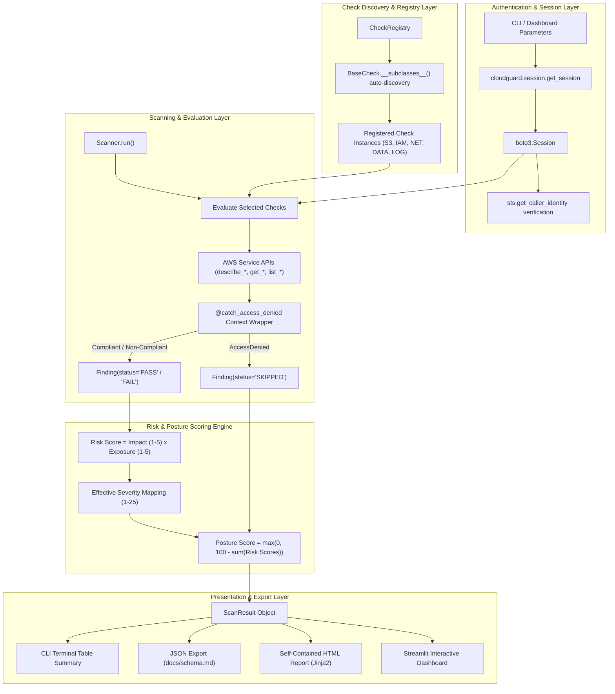
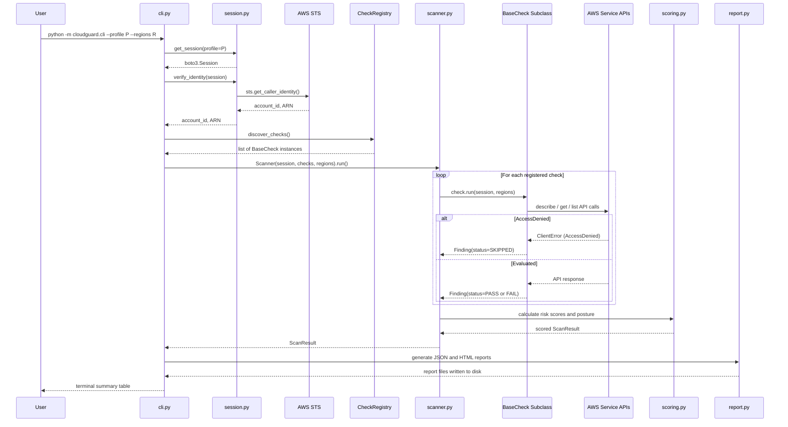

# CloudGuard System Architecture

This document describes the architectural design, component model, execution lifecycle, and data flow of CloudGuard.

---

## 1. System Overview

CloudGuard is a modular, read-only security assessment framework designed to evaluate AWS cloud environments against CIS AWS Foundations Benchmark controls. It is structured into decoupled layers for authentication, check discovery, execution, quantitative risk scoring, and multi-format reporting.

---

## 2. Architecture Diagram

---

## 3. Core Subsystems

### 3.1 Authentication and Identity Verification (`cloudguard/session.py`)
- Provides factory methods to construct authenticated `boto3.Session` instances using optional CLI named profiles and AWS region targets.
- Pre-flight identity verification invokes `sts.get_caller_identity` to extract the 12-digit AWS account identifier and principal ARN.
- Catches authentication exceptions (`NoCredentialsError`, `PartialCredentialsError`, `ProfileNotFound`) and returns explicit diagnostic error messages.

### 3.2 Check Framework and Auto-Discovery (`cloudguard/checks/`)
- `BaseCheck` defines the abstract base contract:
  - `check_id`: Canonical alphanumeric identifier (e.g., `S3-01`, `IAM-02`).
  - `title`: Plain-text check summary.
  - `module`: Target infrastructure domain (`s3`, `iam`, `network`, `data`, `logging`).
  - `base_severity`: Inherent severity rating (`CRITICAL`, `HIGH`, `MEDIUM`, `LOW`).
  - `cis_reference`: Associated CIS AWS Foundations Benchmark control title.
  - `run(session, regions)`: Asynchronous or synchronous inspection method returning `list[Finding]`.
- `CheckRegistry`: Implements dynamic subclass inspection. Any class extending `BaseCheck` defined inside the `cloudguard.checks` namespace is registered automatically at runtime without manual manifest updates.
- Resilient Error Boundary: The `catch_access_denied` decorator intercepts `botocore.exceptions.ClientError` with code `AccessDenied` or `UnauthorizedOperation`, generating a structured finding with status `SKIPPED` instead of crashing.

### 3.3 Domain Check Modules
- **S3 (`checks/s3.py`):** Evaluates public access block settings at bucket and account levels, access control lists (ACLs), bucket policies, default server-side encryption (SSE-S3 / SSE-KMS), and object versioning. Resolves bucket regional endpoints before issuing regional requests.
- **IAM (`checks/iam.py`):** Inspects user console login profiles against active MFA devices, parses customer-managed and inline policy documents for unrestricted administrative statements (`Action: "*"` and `Resource: "*"`), checks access key ages and 90-day inactivity, and verifies the absence of root account access keys.
- **Network (`checks/network.py`):** Evaluates EC2 security group ingress rules across all configured regions. Flags rules exposing port 22 (SSH) or port 3389 (RDP) to public CIDRs (`0.0.0.0/0` or `::/0`), and flags rules permitting unrestricted protocols (`-1`).
- **Data (`checks/data.py`):** Multi-region assessment of unencrypted EBS volumes and RDS database instances (flagging storage encryption and public accessibility independently).
- **Logging (`checks/logging_checks.py`):** Verifies the existence of at least one multi-region CloudTrail trail that is actively capturing events.

### 3.4 Risk Scoring Engine (`cloudguard/scoring.py`)
- Evaluates risk along two distinct dimensions:
  1. **Impact (1 to 5):** Derived from base severity.
  2. **Exposure (1 to 5):** Derived from context (e.g., public internet reachability, active status).
- Computes finding risk scores ($1 \le \text{Risk} \le 25$) and maps composite scores to effective severity bands.
- Calculates overall account posture ($0.0 \le \text{Posture} \le 100.0$) through deterministic linear deduction.

### 3.5 Reporting and Presentation Layer
- **Command-Line Interface (`cloudguard/cli.py`):** Formats summary findings into terminal tables and saves output files.
- **JSON Report Generator (`cloudguard/report.py`):** Serializes scan metadata, posture metrics, and findings according to `docs/schema.md`.
- **HTML Report Generator (`templates/report.html.j2`):** Renders self-contained HTML documents with embedded CSS, zero external HTTP dependencies, and printable styling.
- **Streamlit Dashboard (`dashboard/app.py`):** Interactive analytical web application providing real-time scanning, offline file inspection, metric distribution charts, and multi-field filtering.

---

## 4. Scan Execution Lifecycle

The following sequence diagram illustrates the end-to-end execution flow of a CloudGuard scan from CLI invocation through report generation:

---

## 5. Module Dependency Map

| Module | Dependencies | Purpose |
| :--- | :--- | :--- |
| `cloudguard/session.py` | `boto3`, `botocore` | Session factory, STS identity verification |
| `cloudguard/config.py` | stdlib only | Environment variable resolution |
| `cloudguard/models.py` | stdlib only | `Finding`, `ScanResult`, `Severity` enum |
| `cloudguard/checks/base.py` | `botocore` | Abstract `BaseCheck`, error boundary helpers |
| `cloudguard/checks/registry.py` | `cloudguard.checks.base` | Dynamic subclass discovery |
| `cloudguard/checks/s3.py` | `base`, `scoring`, `boto3` | S3-01, S3-02, S3-03 |
| `cloudguard/checks/iam.py` | `base`, `scoring`, `boto3` | IAM-01, IAM-02, IAM-03, IAM-04 |
| `cloudguard/checks/network.py` | `base`, `scoring`, `boto3` | NET-01, NET-02 |
| `cloudguard/checks/data.py` | `base`, `scoring`, `boto3` | DATA-01, DATA-02 |
| `cloudguard/checks/logging_checks.py` | `base`, `scoring`, `boto3` | LOG-01 |
| `cloudguard/scoring.py` | `cloudguard.models` | Risk and posture computation |
| `cloudguard/scanner.py` | `registry`, `scoring`, `models` | Check orchestration |
| `cloudguard/report.py` | `jinja2`, `models` | HTML and JSON report generation |
| `cloudguard/cli.py` | `session`, `scanner`, `report`, `config` | CLI argument parsing and orchestration |
| `dashboard/app.py` | `streamlit`, `pandas`, all core modules | Interactive web dashboard |

